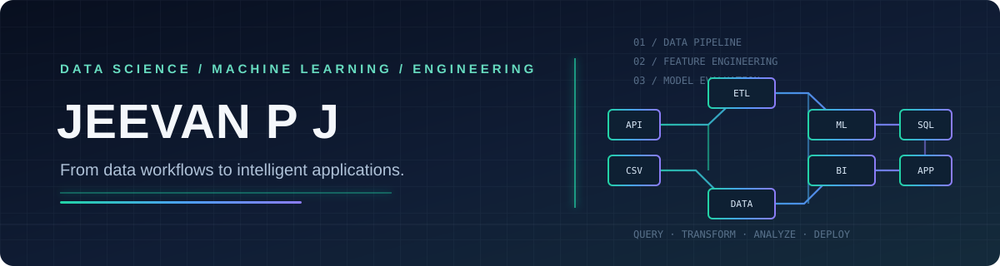

### DATA SCIENCE · MACHINE LEARNING · DATA ENGINEERING

Building practical data solutions — from raw data and analysis to predictive models and deployed applications.

[**Portfolio**](https://jeevanpj.github.io/data-science-machine-learning/) · [**Projects**](https://github.com/jeevanpj/data-science-machine-learning) · [**LinkedIn**](https://www.linkedin.com/in/jeevanpj/)

 

---

## 👋 About

I am an Electronics and Instrumentation Engineering graduate focused on building a career in **Data Science, Machine Learning and Data Engineering**. I enjoy working through the complete problem-solving workflow: understanding the problem, collecting and preparing data, exploring patterns, building models or pipelines, evaluating results, and presenting useful outputs through applications.

My projects are practical implementations designed to strengthen my skills in Python, data analysis, machine learning, API integration, databases and deployment.

## 🎯 Current focus

- End-to-end data science and machine learning workflows
- Data cleaning, exploratory data analysis and feature engineering
- Model development, comparison and evaluation
- API integration and ETL pipeline development
- Interactive analytics applications and deployment
- Building reliable, well-documented project repositories

## 🧰 Technical toolkit

| Area | Tools and technologies |
|---|---|
| Programming | Python, SQL |
| Data analysis | Pandas, NumPy |
| Visualization | Matplotlib, Seaborn, Plotly |
| Machine learning | Scikit-learn, XGBoost |
| Data engineering | REST APIs, Requests, ETL, SQLite |
| Applications & deployment | Streamlit |
| Development tools | Jupyter Notebook, Anaconda, VS Code, Git, GitHub |

## 🚀 Selected projects

###  StockSense — Stock Trend Prediction

An end-to-end stock analysis application for Reliance Industries. It works with historical market data and technical indicators to explore price behaviour and experiment with next-day direction classification using machine learning models.

**Focus:** Time-series data · Technical indicators · Classification · Model evaluation

**Built with:** Python, yfinance, Pandas, NumPy, Random Forest, XGBoost, Streamlit

[**↗ Live application**](https://stocksense-stock-trend-prediction-ml5hw5zrll3tmznavz6r7c.streamlit.app/) · [**↗ Source code**](https://github.com/jeevanpj/StockSense-Stock-Trend-Prediction)

---

###  Inventory Stock Risk Prediction

A machine learning project that analyses inventory-related features to classify stock risk, including stockout and overstock conditions. The workflow covers data preparation, exploratory analysis, feature engineering, model comparison and evaluation, with an interactive prediction application.

**Focus:** Classification · Inventory analytics · Feature engineering · Model evaluation

**Built with:** Python, Pandas, Scikit-learn, Gradient Boosting, Streamlit

[**↗ Live application**](https://data-science-machine-learning-fznu5w5wlnbwajtyz6tvn4.streamlit.app/) · [**↗ Source code**](https://github.com/jeevanpj/data-science-machine-learning/tree/main/projects/Inventory-Stock-Risk-Prediction)

---

###  DataFlow — API-Based ETL Pipeline

An end-to-end data engineering project that extracts weather data from the Open-Meteo API and economic indicator data from the World Bank API, transforms the records using Python and Pandas, and loads them into a SQLite warehouse. A Streamlit dashboard presents the datasets, interactive charts and ETL execution history.

**Focus:** REST API integration · Extract, Transform, Load (ETL) · Data transformation · Data warehousing

**Built with:** Python, Requests, Pandas, SQLite, Streamlit, Plotly

[**↗ Live application**](https://data-science-machine-learning-o9aglogqxhhnsmn3braox4.streamlit.app/) · [**↗ Source code**](https://github.com/jeevanpj/data-science-machine-learning/tree/main/projects/DataFlow_ETL_Project)

---

## 🎓 Education & learning

- **Bachelor of Engineering — Electronics and Instrumentation**, Bangalore Institute of Technology
- **Data Science training**, ExcelR, Bengaluru
- **Generative AI / Android app development internship**

## 🤝 Connect

---

*Learn continuously · Build practically · Improve deliberately*

